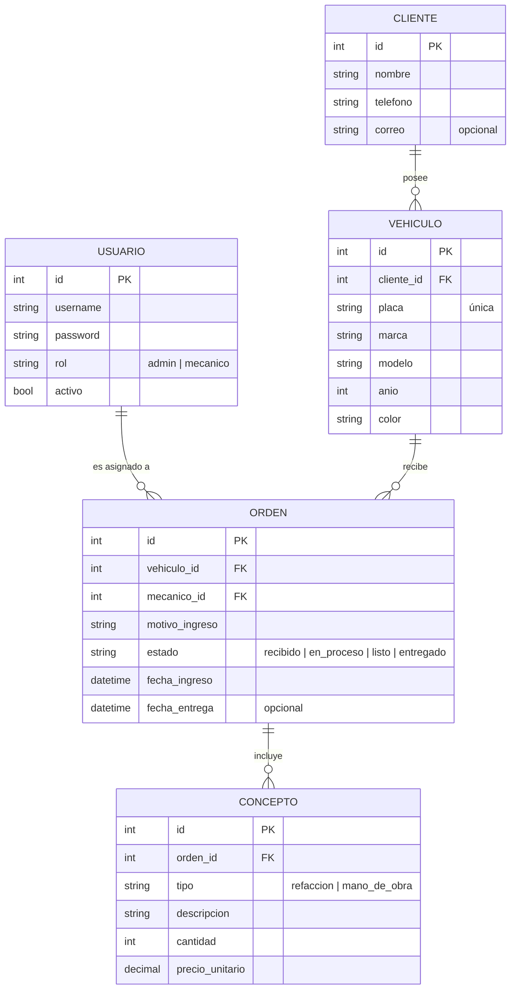
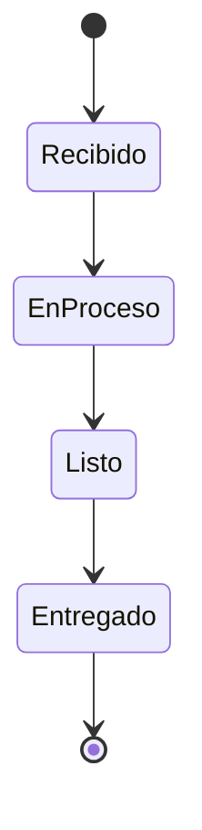
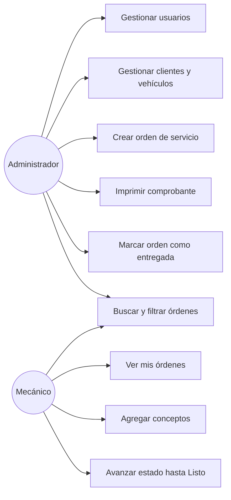

# Diseño — TallerPro MVP

## Arquitectura

Aplicación monolítica Django con plantillas del lado del servidor (patrón MTV).

Apps propuestas:

| App | Responsabilidad |
|---|---|
| `accounts` | Usuarios, roles y autenticación |
| `clientes` | Clientes y vehículos |
| `ordenes` | Órdenes de servicio, conceptos y flujo de estados |

## Modelo de datos (ER)



El total de la orden no se guarda: se calcula como la suma de `cantidad × precio_unitario` de sus conceptos.

## Flujo de estados de la orden



## Casos de uso



## Rutas principales (propuesta)

| Ruta | Vista | Acceso |
|---|---|---|
| `/login/`, `/logout/` | Autenticación | Todos |
| `/clientes/` | Lista y búsqueda de clientes | Admin |
| `/clientes/<id>/` | Detalle del cliente y sus vehículos | Admin |
| `/vehiculos/<id>/` | Detalle del vehículo e historial | Admin, Mecánico |
| `/ordenes/` | Lista con filtros | Admin, Mecánico (solo las suyas) |
| `/ordenes/nueva/` | Crear orden | Admin |
| `/ordenes/<id>/` | Detalle, conceptos y cambio de estado | Admin, Mecánico (si es suya) |
| `/ordenes/<id>/imprimir/` | Comprobante imprimible | Admin |

## Estructura de carpetas

```
tallerpro-mvp/
├── README.md
├── docs/
├── manage.py
├── config/            # settings, urls
├── accounts/
├── clientes/
├── ordenes/
├── templates/
├── static/
└── tests/
```